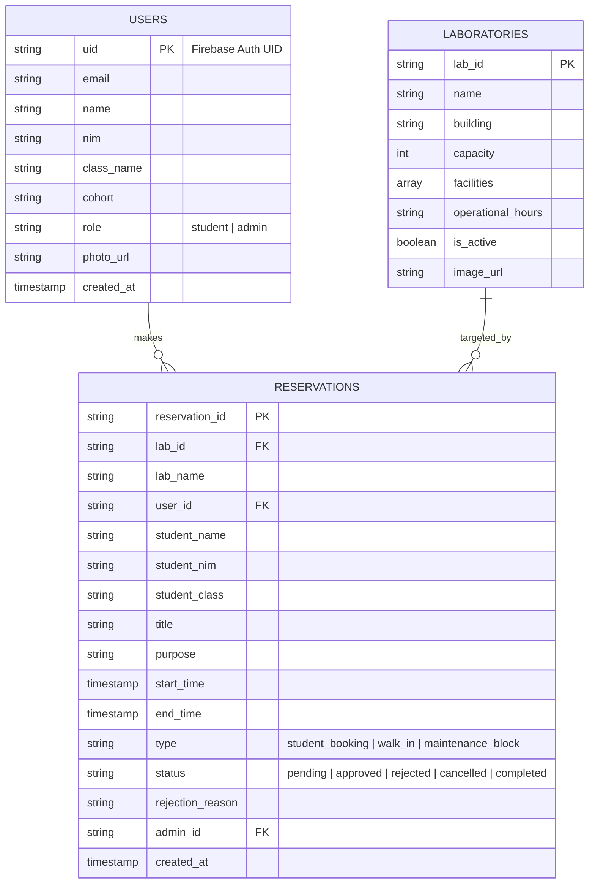

# Dokumen Perancangan Aplikasi LabBook (Campus Laboratory Reservation)

**Tema Proyek:** Pengembangan Aplikasi Mobile Berbasis Flutter untuk Menyelesaikan Permasalahan Nyata di Lingkungan Kampus  
**Nama Aplikasi:** **LabBook**  
**Teknologi:** Flutter, Dart, Firebase Authentication, Cloud Firestore, Cloud Storage  

---

## 1. Analisis Kebutuhan Pengguna

### A. Fitur Mahasiswa
1. **Registrasi & Autentikasi:**
   - Pembuatan akun baru & login menggunakan Firebase Authentication.
   - Melengkapi profil akademik: NIM, Nama Lengkap, Kelas, dan Tahun Angkatan.
2. **Katalog Laboratorium:**
   - Melihat daftar laboratorium yang aktif di kampus.
   - Melihat detail spesifikasi: fasilitas (jumlah PC, alat uji, AC, proyektor), kapasitas meja, dan jam operasional.
3. **Kalender Jadwal Interaktif:**
   - Visualisasi jadwal lab ala Google Calendar (tampilan blok waktu jam mulai s/d selesai).
   - Melihat slot kosong maupun slot yang sudah terisi agenda lain.
4. **Pengajuan Reservasi (Booking):**
   - Memilih tanggal, jam mulai, dan jam selesai.
   - Mengisi agenda/keperluan peminjaman (misal: Riset Tugas Akhir, Kerja Kelompok).
   - Validasi bentrok otomatis: sistem mencegah booking jika bertabrakan dengan jadwal lain yang sudah disetujui.
5. **Manajemen Reservasi Mandiri:**
   - Pelacakan status secara *real-time*: `Pending` (Kuning), `Approved` (Hijau), `Rejected` (Merah), `Cancelled` (Abu-abu).
   - Pembatalan booking mandiri sebelum jadwal berlangsung.
   - Melihat catatan/alasan penolakan dari laboran apabila booking ditolak.

### B. Fitur Admin / Asisten Laboratorium
1. **Dashboard Ringkasan Operasional:**
   - Statistik harian: jumlah booking menunggu persetujuan (*pending*), jumlah lab aktif, dan total peminjaman hari ini.
2. **Pusat Persetujuan (Approval Center):**
   - Meninjau pengajuan mahasiswa beserta detail agenda dan data mahasiswa.
   - Menyetujui (*Approve*) atau Menolak (*Reject*) dengan wajib menyertakan alasan penolakan.
3. **Booking Manual (Walk-in Booking):**
   - Memfasilitasi input pemesanan manual di tempat untuk mahasiswa yang datang langsung ke meja asisten lab.
4. **Manajemen Laboratorium (CRUD Lab):**
   - Menambah lab baru, memperbarui informasi fasilitas/kapasitas/jam operasional, atau menonaktifkan lab sementara.
5. **Blokir Jadwal (Maintenance / Regular Class Block):**
   - Mengunci slot waktu tertentu di kalender untuk praktikum mata kuliah reguler atau perawatan/pemeliharaan berkala agar tidak bisa di-booking oleh mahasiswa.
6. **Laporan & Riwayat Penggunaan:**
   - Riwayat riil riwayat peminjaman untuk evaluasi utilisasi laboratorium kampus.

---

## 2. Perancangan Struktur Data Firebase Cloud Firestore



---

## 3. Alur Logika Penting (Business Logic)

### A. Pencegahan Jadwal Bentrok (Conflict Prevention)
Sebelum sebuah pengajuan booking disimpan ke Firestore, aplikasi menjalankan validasi query:
```dart
// Kondisi bentrok: (start_time < existing.end_time) AND (end_time > existing.start_time)
// Pada lab yang sama dan status 'approved' atau 'maintenance_block'
```
Jika ditemukan jadwal yang beririsan, form booking menampilkan pesan peringatan interaktif dan meminta pengguna memilih jam lain.

### B. Role-Based Navigation
- Setelah login, aplikasi membaca field `role` pada koleksi `users`.
- Pengguna dengan role `student` diarahkan ke **Student Dashboard** (Katalog Lab, Kalender, Form Booking, Riwayat Saya).
- Pengguna dengan role `admin` diarahkan ke **Admin Dashboard** (Approval Queue, Kelola Lab, Blokir Jadwal, Walk-in).

---

## 4. Pembagian Kerja Kelompok & Timeline 4 Minggu

| Minggu | Target Deliverables SPADA & GitHub | Penanggung Jawab Rekomendasi |
|:---:|---|---|
| **Minggu 1** | Inisialisasi repo Flutter, struktur folder Clean Architecture, setup Firebase project, perancangan mockup UI & ERD. | Seluruh Anggota |
| **Minggu 2** | Implementasi Auth (Login/Register/Lengkapi Profil), Halaman Katalog Lab (CRUD untuk Admin), Navigasi BottomBar. | Anggota 1 & Anggota 2 |
| **Minggu 3** | Implementasi Kalender Google-style (`syncfusion_flutter_calendar`), Form Booking + Conflict Check, Panel Approval Admin. | Anggota 3 & Anggota 4 |
| **Minggu 4** | Walk-in booking, Blokir maintenance, penanganan edge cases/bug fixing, pengujian fungsional, dan penyusunan laporan akhir PDF. | Seluruh Anggota |
