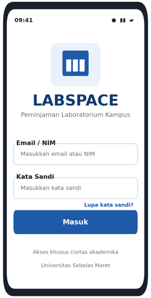
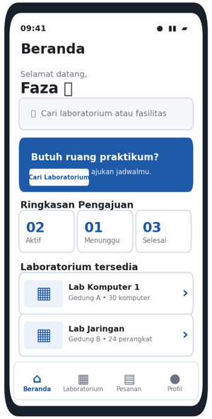
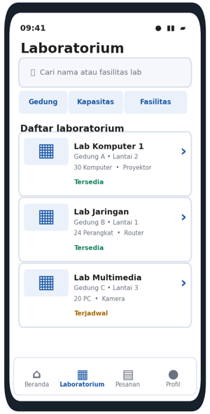
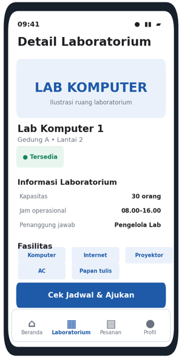
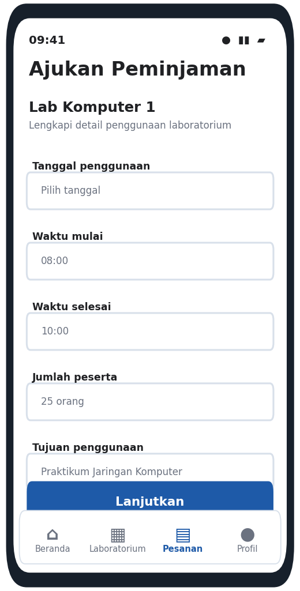

# 🔬 LabBook — Campus Laboratory Reservation App

[](https://flutter.dev)
[](https://dart.dev)
[](https://firebase.google.com)
[](https://firebase.google.com/docs/firestore)

Aplikasi mobile berbasis **Flutter** untuk memfasilitasi peminjaman dan reservasi laboratorium di lingkungan kampus secara transparan, terintegrasi, dan *real-time*. Proyek ini dikembangkan untuk menyelesaikan permasalahan bentrok jadwal praktikum, birokrasi manual berbasis kertas, dan ketiadaan informasi ketersediaan fasilitas laboratorium.

---

## 🔍 Identifikasi Masalah & Solusi

### A. Identifikasi Masalah

Laboratorium kampus memiliki tingkat utilisasi tinggi untuk kegiatan praktikum berkala, riset tugas akhir mahasiswa, penelitian dosen, maupun workshop organisasi mahasiswa. Namun, operasional saat ini kerap menemui kendala, yaitu:

1. **Jadwal Bentrok:** Belum tersedia sistem kalender terpadu yang menampilkan jadwal penggunaan laboratorium secara real-time sehingga berpotensi terjadi pemesanan ganda pada ruangan yang sama.
2. **Birokrasi Manual:** Proses pengajuan peminjaman masih menggunakan formulir kertas atau pesan personal kepada petugas/laboran sehingga pengajuan berisiko tercecer dan sulit dipantau.
3. **Kurangnya Transparansi Fasilitas:** Mahasiswa kesulitan mengetahui informasi fasilitas laboratorium, seperti jumlah PC, jenis peralatan, proyektor, AC, kapasitas ruangan, dan jam operasional.

### B. Solusi yang Diusulkan

**LabBook** merupakan aplikasi mobile berbasis Flutter dengan dukungan Firebase (Authentication, Cloud Firestore, dan Cloud Storage) yang dirancang untuk mempermudah proses reservasi dan pengelolaan laboratorium kampus.

Solusi yang ditawarkan meliputi:

- **Kalender Interaktif:** Menampilkan jadwal dan ketersediaan laboratorium secara real-time.
- **Reservasi Mandiri:** Memungkinkan mahasiswa mengajukan peminjaman laboratorium dengan validasi otomatis untuk mencegah jadwal bentrok.
- **Sistem Approval:** Menyediakan sistem persetujuan dan penolakan pengajuan reservasi oleh asisten lab/laboran, termasuk informasi alasan penolakan.

**LabBook** hadir sebagai solusi terpadu dengan menyediakan kalender interaktif ala *Google Calendar*, sistem booking mandiri dengan pencegahan bentrok otomatis, serta panel pengelolaan persetujuan (*approval*) untuk asisten laboratorium.

---

## 🚀 Fitur yang Dikembangkan

Aplikasi LabBook memiliki dua jenis pengguna, yaitu Mahasiswa (Student) dan Admin/Asisten Laboratorium.

### A. Fitur Mahasiswa (Student)

1. **Registrasi & Login:** Pendaftaran dan autentikasi pengguna menggunakan Firebase Authentication.
2. **Profil Mahasiswa:** Melengkapi identitas mahasiswa berupa NIM, nama lengkap, kelas, dan angkatan.
3. **Katalog Laboratorium:** Melihat daftar laboratorium beserta fasilitas, kapasitas, dan jam operasional.
4. **Kalender Ketersediaan:** Melihat jadwal penggunaan laboratorium secara real-time.
5. **Pengajuan Reservasi:** Mengajukan booking berdasarkan tanggal serta rentang waktu mulai dan selesai.
6. **Riwayat Booking:** Memantau status reservasi, yaitu Pending, Approved, Rejected, dan Cancelled.
7. **Pembatalan Booking:** Membatalkan reservasi milik sendiri sebelum jadwal berlangsung.
8. **Informasi Penolakan:** Melihat alasan apabila pengajuan reservasi ditolak oleh admin.

### B. Fitur Admin / Asisten Laboratorium

1. **Dashboard Admin:** Menampilkan ringkasan penggunaan laboratorium, seperti jumlah booking pending, laboratorium aktif, dan peminjaman hari ini.
2. **Approval Reservasi:** Menyetujui (Approve) atau menolak (Reject) pengajuan booking mahasiswa.
3. **Walk-in Booking:** Memasukkan reservasi secara manual untuk mahasiswa yang datang langsung ke meja piket.
4. **Manajemen Laboratorium:** Menambah, mengubah informasi, dan menonaktifkan data laboratorium.
5. **Pengaturan Fasilitas:** Mengatur fasilitas, kapasitas meja, dan jam operasional laboratorium.
6. **Maintenance Schedule:** Memblokir jadwal tertentu untuk praktikum reguler atau pemeliharaan laboratorium.
7. **Riwayat dan Laporan:** Mengelola seluruh data reservasi serta melihat riwayat penggunaan laboratorium.
---

## 🛠️ Arsitektur Teknologi & Database

### Tech Stack
- **Framework:** Flutter (Channel Stable)
- **Language:** Dart
- **Backend as a Service:** Firebase
  - **Firebase Authentication:** Manajemen sesi & login pengguna
  - **Cloud Firestore:** Database NoSQL *real-time* untuk data lab, pengguna, dan reservasi
  - **Firebase Storage:** Penyimpanan berkas dan foto laboratorium
- **State Management:** Provider / Riverpod

### Skema Cloud Firestore
Aplikasi mengelola 3 koleksi data utama:
1. `users` — Data profil mahasiswa dan akun admin/asisten lab (`uid`, `name`, `nim`, `class_name`, `cohort`, `role`).
2. `laboratories` — Informasi ruangan lab (`lab_id`, `name`, `building`, `capacity`, `facilities`, `operational_hours`, `is_active`).
3. `reservations` — Data transaksi peminjaman & blokir jadwal (`reservation_id`, `lab_id`, `user_id`, `start_time`, `end_time`, `status`, `rejection_reason`, `admin_id`).

---

## 🎨 Rancangan Antarmuka Aplikasi

Rancangan antarmuka LabBook dibuat untuk mempermudah mahasiswa dan admin dalam menggunakan sistem reservasi laboratorium.

### A. Halaman Login

Menampilkan formulir autentikasi agar pengguna dapat masuk ke aplikasi menggunakan akun yang telah terdaftar.



### B. Halaman Beranda

Menampilkan halaman utama aplikasi sebagai pusat navigasi menuju fitur-fitur LabBook.



### C. Halaman Katalog Laboratorium

Menampilkan daftar laboratorium yang tersedia beserta informasi fasilitas dan kapasitasnya.



### D. Halaman Detail Laboratorium

Menampilkan informasi lengkap mengenai laboratorium yang dipilih, termasuk fasilitas, kapasitas, dan jam operasional.



### E. Halaman Form Reservasi

Menampilkan formulir pengajuan peminjaman laboratorium untuk memilih tanggal, waktu, dan keperluan penggunaan.



---

## 🗄️ Perancangan Struktur Data Cloud Firestore

LabBook menggunakan **Cloud Firestore** sebagai database NoSQL untuk menyimpan data pengguna, informasi laboratorium, dan reservasi.

### A. Collection: `users`

Digunakan untuk menyimpan informasi akun dan identitas pengguna aplikasi.

| Field | Tipe Data | Keterangan |
|---|---|---|
| uid | String | ID pengguna dari Firebase Authentication (Primary Key) |
| email | String | Alamat email pengguna |
| name | String | Nama lengkap pengguna |
| nim | String | Nomor Induk Mahasiswa |
| class_name | String | Kelas mahasiswa, contoh: IF-A |
| cohort | String | Angkatan mahasiswa, contoh: 2023 |
| role | String | Hak akses: student atau admin |
| photo_url | String | URL foto profil pengguna |
| created_at | Timestamp | Waktu pembuatan akun |

### B. Collection: `laboratories`

Digunakan untuk menyimpan informasi dan data fasilitas laboratorium.

| Field | Tipe Data | Keterangan |
|---|---|---|
| lab_id | String | ID laboratorium (Primary Key) |
| name | String | Nama laboratorium |
| building | String | Lokasi gedung dan lantai laboratorium |
| capacity | Integer | Kapasitas kursi atau komputer |
| facilities | Array of String | Daftar fasilitas laboratorium |
| operational_hours | String | Jam operasional laboratorium |
| is_active | Boolean | Status aktif atau tidak aktif |
| image_url | String | URL gambar laboratorium |

### C. Collection: `reservations`

Digunakan untuk menyimpan seluruh data pengajuan dan aktivitas reservasi laboratorium.

| Field | Tipe Data | Keterangan |
|---|---|---|
| reservation_id | String | ID reservasi (Primary Key) |
| lab_id | String | Referensi ID laboratorium |
| lab_name | String | Nama laboratorium |
| user_id | String | Referensi UID pengguna |
| student_name | String | Nama mahasiswa |
| student_nim | String | NIM mahasiswa |
| student_class | String | Kelas mahasiswa |
| title | String | Judul atau keperluan reservasi |
| purpose | String | Rincian kegiatan |
| start_time | Timestamp | Waktu mulai reservasi |
| end_time | Timestamp | Waktu selesai reservasi |
| type | String | student_booking, walk_in, atau maintenance_block |
| status | String | pending, approved, rejected, cancelled, atau completed |
| rejection_reason | String | Alasan penolakan reservasi |
| admin_id | String | UID admin yang menyetujui atau menolak reservasi |
| created_at | Timestamp | Waktu pembuatan data reservasi |

### D. Relasi Antar Koleksi

Meskipun Cloud Firestore merupakan database NoSQL, hubungan antar data dilakukan menggunakan ID sebagai referensi.

- Koleksi `users` menyimpan data mahasiswa dan admin.
- Koleksi `laboratories` menyimpan informasi laboratorium.
- Koleksi `reservations` menghubungkan data pengguna dengan laboratorium melalui field `user_id` dan `lab_id`.

Dengan struktur tersebut, sistem dapat mengelola data pengguna, laboratorium, dan reservasi secara terorganisasi.

---

## 👥 Anggota Kelompok & Pembagian Tugas

| No | Nama Mahasiswa | NIM | Username GitHub | Peran & Tanggung Jawab Utama |
|:--:|---|:---:|:---:|---|
| 1 | **Muhammad Dava Syahputra** | NIM K3524058 | [@Davyrann](https://github.com/Davyrann) | **Backend & Architecture Lead** |
| 2 | **Fatih Nur Faiq** | NIM K3524052 | [@Fatih-faiq](https://github.com/Pluto-404) | **Student Experience Lead** |
| 3 | **Muhammad Raihan Faza** | NIM K3524060 | [@raihan-23-git](https://github.com/raihan-23-git) | **Core Booking & Calendar Lead** |
| 4 | **Ghali Shiddiq Fatullah** | NIM K3524054 | [@ghaliishiddiq12](https://github.com/ghaliishiddiq12/) | **Admin & Management Lead** |


## 💻 Panduan Instalasi & Menjalankan Proyek

Bagi anggota kelompok yang ingin menjalankan proyek ini di perangkat lokal:

### 1. Prasyarat
- [Flutter SDK](https://docs.flutter.dev/get-started/install) (versi 3.19 ke atas)
- [Dart SDK](https://dart.dev/get-dart)
- Android Studio / VS Code dengan ekstensi Flutter & Dart
- Akun Google / Firebase yang telah diundang sebagai Collaborator project

### 2. Kloning Repositori
```bash
git clone https://github.com/Pluto-404/lab-reservation-app.git
cd lab-reservation-app
```

### 3. Mengambil Dependensi
```bash
flutter pub get
```

### 4. Konfigurasi Firebase (Khusus Anggota Baru)
Pastikan FlutterFire CLI terinstal, lalu jalankan konfigurasi:
```bash
flutterfire configure
```
Pilih project Firebase kelompok yang telah dibuat.

### 5. Menjalankan Aplikasi
```bash
flutter run
```

---

## 📅 Roadmap Perkembangan Proyek (4 Minggu)

Jadwal kerja proyek LabBook dibagi menjadi 4 minggu dengan pembagian tugas dan target commit GitHub untuk setiap anggota kelompok.

### Minggu 1 – Persiapan dan Perancangan

| Anggota | Tugas Pokok | Target Commit GitHub |
|---|---|---|
| Muhammad Dava Syahputra | Setup Firebase (Auth, Firestore), menyusun skema data dan hak akses. | `docs: inisialisasi skema firestore dan konfigurasi backend` |
| Fatih Nur Faiq | Membuat wireframe UI Mahasiswa (Login, Register, Profil, Katalog Lab). | `docs: wireframe antarmuka mahasiswa dan katalog` |
| Muhammad Raihan Faza | Inisialisasi proyek Flutter, wireframe kalender dan form booking. | `chore: inisialisasi flutter dan struktur navigasi awal` |
| Ghali Shiddiq Fatullah | Membuat wireframe UI Admin, Dashboard dan laporan pengumpulan SPADA Minggu 1. | `docs: panduan kontribusi dan mockup admin dashboard` |

### Minggu 2 – Implementasi Fitur Dasar

| Anggota | Tugas Pokok | Target Commit GitHub |
|---|---|---|
| Muhammad Dava Syahputra | Implementasi AuthService, UserModel, LabModel, dan FirestoreService. | `feat(auth): implementasi AuthService dan UserModel` |
| Fatih Nur Faiq | Implementasi halaman Register, Login, Profil, dan Katalog Lab. | `feat(ui): antarmuka login, profil mahasiswa, dan katalog lab` |
| Muhammad Raihan Faza | Implementasi navigasi BottomBar dan integrasi kalender mingguan. | `feat(calendar): implementasi antarmuka kalender mingguan` |
| Ghali Shiddiq Fatullah | Implementasi Dashboard Admin dan form Tambah/Edit Lab (CRUD Lab). | `feat(admin): antarmuka kelola lab dan integrasi crud` |

### Minggu 3 – Implementasi Fitur Lanjutan

| Anggota | Tugas Pokok | Target Commit GitHub |
|---|---|---|
| Muhammad Dava Syahputra | Query realtime kalender Firestore dan Security Rules. | `feat(backend): query realtime kalender dan security rules` |
| Fatih Nur Faiq | Membuat halaman Riwayat Booking Mahasiswa, fitur pembatalan, dan dialog alasan penolakan. | `feat(booking): riwayat peminjaman mahasiswa dan pembatalan` |
| Muhammad Raihan Faza | Membuat form pengajuan booking dan logika validasi jadwal bentrok. | `feat(booking): form booking dan validasi jadwal bentrok` |
| Ghali Shiddiq Fatullah | Membuat Pusat Persetujuan (Approval Center) untuk menyetujui dan menolak booking. | `feat(admin): sistem approval dan penolakan booking` |

### Minggu 4 – Pengujian dan Finalisasi

| Anggota | Tugas Pokok | Target Commit GitHub |
|---|---|---|
| Muhammad Dava Syahputra | Optimasi query Firestore, offline support, dan seeder data demo. | `perf: optimasi query firestore dan penyusunan seeder data` |
| Fatih Nur Faiq | Polishing UI mahasiswa, dokumentasi screenshot, serta penyusunan Bab 1 dan 2 Laporan Akhir. | `docs: dokumentasi screenshot dan penyusunan bab 1 2` |
| Muhammad Raihan Faza | Pengujian fungsional (Black-box) dan penyusunan Bab 5 Laporan Akhir. | `test: skenario pengujian kalender dan validasi booking` |
| Ghali Shiddiq Fatullah | Implementasi fitur Walk-in Booking, blokir maintenance, dan finalisasi slide presentasi serta laporan. | `feat(admin): fitur walk-in booking dan finalisasi laporan` |

---

## 🎥 Rencana Demonstrasi Aplikasi

Demonstrasi dilakukan untuk memperlihatkan cara kerja aplikasi LabBook, mulai dari proses login mahasiswa hingga pengelolaan reservasi oleh admin.

### 1. Persiapan Demonstrasi

Sebelum demonstrasi dimulai, tim menyiapkan:
- Aplikasi LabBook yang sudah dapat dijalankan.
- Akun mahasiswa dan akun admin untuk pengujian.
- Data laboratorium beserta informasi fasilitas dan kapasitas.
- Data jadwal laboratorium untuk simulasi reservasi.
- Koneksi internet untuk mengakses Firebase.

### 2. Skenario Demonstrasi

| No. | Skenario | Aktivitas Demonstrasi |
|---|---|---|
| 1 | Login Mahasiswa | Menunjukkan proses login dan registrasi menggunakan Firebase Authentication. |
| 2 | Profil Mahasiswa | Menampilkan informasi identitas mahasiswa. |
| 3 | Katalog Laboratorium | Menampilkan daftar laboratorium, fasilitas, kapasitas, dan jam operasional. |
| 4 | Kalender Laboratorium | Menunjukkan jadwal ketersediaan laboratorium. |
| 5 | Pengajuan Reservasi | Mahasiswa memilih laboratorium, tanggal, waktu, dan mengirim pengajuan booking. |
| 6 | Validasi Jadwal | Menunjukkan proses pencegahan jadwal reservasi yang bentrok. |
| 7 | Persetujuan Admin | Admin melihat pengajuan dan melakukan persetujuan atau penolakan reservasi. |
| 8 | Riwayat Reservasi | Menampilkan status dan riwayat booking mahasiswa. |
| 9 | Fitur Admin | Menunjukkan pengelolaan data laboratorium, walk-in booking, dan blokir jadwal maintenance. |

### 3. Pembagian Tugas Demonstrasi

| Anggota | Tanggung Jawab |
|---|---|
| Muhammad Dava Syahputra | Menjelaskan integrasi Firebase, Authentication, Firestore, dan pengelolaan data backend. |
| Fatih Nur Faiq | Mendemonstrasikan tampilan dan fitur mahasiswa. |
| Muhammad Raihan Faza | Mendemonstrasikan kalender, pengajuan booking, dan validasi jadwal. |
| Ghali Shiddiq Fatullah | Mendemonstrasikan dashboard admin, persetujuan booking, dan pengelolaan laboratorium. |

### 4. Target Hasil Demonstrasi

- Seluruh fitur utama aplikasi dapat diperlihatkan.
- Proses reservasi mahasiswa dapat berjalan.
- Admin dapat mengelola dan memproses pengajuan reservasi.
- Integrasi Firebase dapat ditunjukkan.
- Tim dapat menjelaskan fungsi dan alur kerja aplikasi LabBook.

### 5. Penutup

Demonstrasi diakhiri dengan penyampaian kesimpulan mengenai fungsi aplikasi LabBook, manfaat sistem reservasi laboratorium, serta hasil pengembangan proyek oleh seluruh anggota kelompok.

---

## 📄 Dokumen Terkait
- [Panduan dan Ketentuan Resmi Proyek](PANDUAN_PROYEK.md)
- [Dokumen Perancangan Teknis & Skema Database](DOKUMEN_PERANCANGAN_LABBOOK.md)

---
*Dikembangkan untuk memenuhi Tugas Proyek Mata Kuliah Pengembangan Aplikasi Mobile.*
