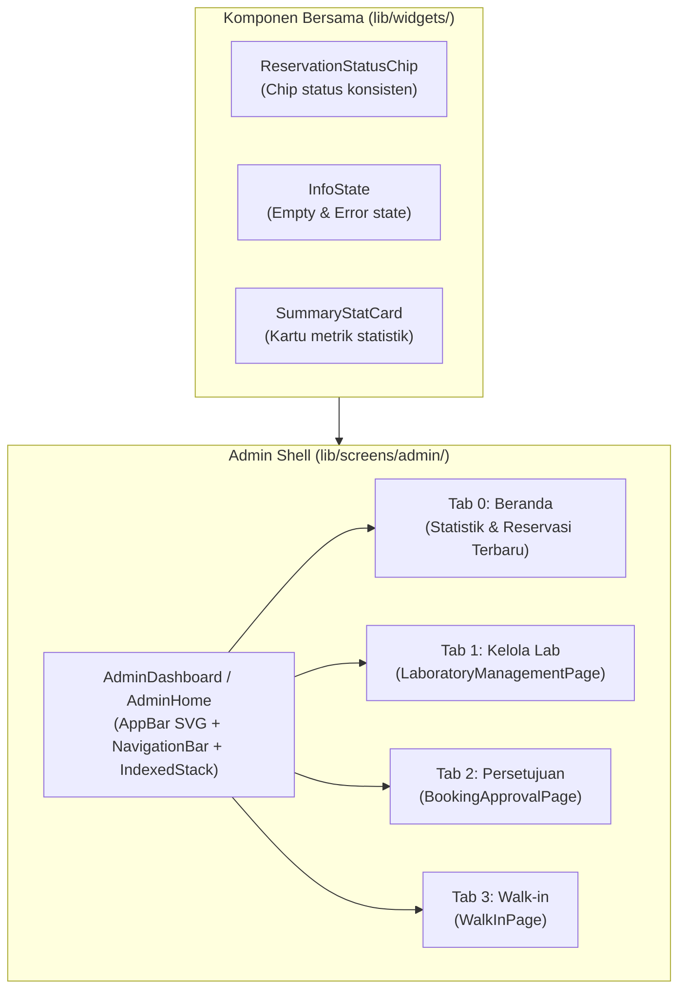

# Rencana Implementasi: Sinkronisasi Front-End Admin dengan Desain Sistem LabBook

> **For agentic workers:** REQUIRED SUB-SKILL: Use superpowers:subagent-driven-development (recommended) or superpowers:executing-plans to implement this plan task-by-task. Steps use checkbox (`- [ ]`) syntax for tracking.

**Goal:** Menyelaraskan seluruh antarmuka (front-end) Admin agar konsisten dengan tampilan Mahasiswa dan panduan desain sistem (`DESIGN.md`), meliputi navigation shell terpadu (`NavigationBar` Material 3 & `IndexedStack`), branding AppBar dengan logo SVG resmi, komponen status chip bersama (`ReservationStatusChip`), info/empty state (`InfoState`), tipografi, form styling, dan kartu metrik.

**Architecture:** Mengadopsi arsitektur shell navigasi terpusat (`AdminDashboard` / `AdminHome`) yang serupa dengan `StudentHome`, mengintegrasikan 4 tab utama (Beranda, Laboratorium, Persetujuan, Walk-in) via `IndexedStack` dengan dukungan mode responsif (desktop sidebar/rail), serta mengekstrak komponen UI reusable (`ReservationStatusChip`, `InfoState`, `SummaryStatCard`) ke direktori bersama agar tidak ada duplikasi kode atau inkonsistensi visual.

**Tech Stack:** Flutter 3.x, Material 3 (`useMaterial3: true`), Cloud Firestore, Firebase Auth, `flutter_svg`, `app_theme.dart`.

**Spec:** [DESIGN.md](file:///D:/GitHub/lab-reservation-app/DESIGN.md)

---

## Global Constraints

- Wajib mengikuti Anti-Slop Rules pada `DESIGN.md` (Section 2 & Section 3): tidak menggunakan gradient sembarangan, bayangan tebal, glassmorphism, atau pill capsule berlebih.
- Menggunakan token warna resmi dari `AppTheme` (`primary` #009BDD, `deep` #0E7DA7, `ink` #172B3A, `muted` #687A8D, `canvas` #F8FAFC, `outline` #E2E8F0, `soft` #EAF7FC, `success`, `warning`, `danger`).
- Navigasi utama mobile menggunakan Material 3 `NavigationBar` dengan label teks yang jelas pada setiap item.
- Layout halaman mobile menggunakan padding horizontal 20--24 dp dan dibatasi dengan `PageWidth` agar tidak merenggang berlebihan pada layar lebar.
- Setiap halaman wajib mendukung 6 state: Loading, Content, Empty (`InfoState`), Error, Disabled, dan Feedback (SnackBar/Dialog).

## Review Focus

1. **Persistent Navigation Shell**: Saat admin berpindah antara Beranda, Laboratorium, Persetujuan, dan Walk-in, shell navigasi (Bottom Bar pada HP atau Sidebar pada Desktop) tidak boleh hilang atau me-reset state pencarian/filter.
2. **Dual-mode Subpages**: Halaman `BookingApprovalPage`, `LaboratoryManagementPage`, dan `WalkInPage` harus dapat berfungsi mulus baik saat di-embed di dalam tab `AdminDashboard` (tanpa AppBar duplikat) maupun saat dibuka sebagai route mandiri via `Navigator` (dengan AppBar dan tombol kembali).
3. **Branding & Identitas Logo**: Header Admin wajib menggunakan aset SVG logo resmi `assets/images/labbook-logo.svg` dan teks `LabBook` bersanding dengan badge `Admin` elegan, selaras dengan `StudentHome`.
4. **Konsistensi Status Chip**: Semua status reservasi di panel admin (tabel/list reservasi terbaru, kartu pengajuan peminjaman, riwayat walk-in) wajib menggunakan `ReservationStatusChip` dengan warna semantik yang tepat.
5. **Keamanan Aksi Destruktif**: Aksi persetujuan, penolakan (dengan alasan wajib), dan penghapusan lab harus memiliki dialog konfirmasi yang jelas dengan tombol aksi spesifik (bukan sekadar "OK").

---

## Proposed Changes



---

### Shared UI Components

#### [NEW] `lib/widgets/reservation_status_chip.dart`
- Mengekstrak atau mere-ekspor `ReservationStatusChip` ke `lib/widgets/` agar menjadi komponen bersama tingkat aplikasi (dipakai oleh Mahasiswa & Admin).
- Mendukung status: `pending`, `approved`, `rejected`, `cancelled`, `completed`, `maintenance_block`.

#### [NEW] `lib/widgets/info_state.dart`
- Mengekstrak atau mere-ekspor `InfoState` ke `lib/widgets/` untuk menampilkan icon, teks keterangan, dan tombol aksi opsional pada empty state dan error state.

#### [NEW] `lib/widgets/summary_stat_card.dart`
- Komponen kartu statistik terpadu dengan style `AppTheme`: border `outline`, icon dalam container rounded `AppTheme.soft`, angka nilai `fontSize: 22, fontWeight: FontWeight.bold`, dan label keterangan `AppTheme.muted`.

---

### Admin Navigation Shell & Dashboard

#### [MODIFY] `lib/screens/admin/admin_dashboard.dart`
- Mengubah arsitektur navigasi:
  - Mengganti `BottomAppBar` + `IconButton` (yang sebelumnya melakukan `Navigator.push` sehingga menghilangkan bottom bar) menjadi Material 3 `NavigationBar` dengan 4 destinasi berlabel:
    1. **Beranda** (`Icons.home_outlined` / `Icons.home`)
    2. **Laboratorium** (`Icons.apartment_outlined` / `Icons.apartment`)
    3. **Persetujuan** (`Icons.fact_check_outlined` / `Icons.fact_check`)
    4. **Walk-in** (`Icons.meeting_room_outlined` / `Icons.meeting_room`)
  - Menggunakan `IndexedStack` untuk menampung tab sehingga transisi mulus dan state terjaga.
  - Untuk layar lebar (`isWide >= 850`), sidebar desktop menyinkronkan index tab yang sama alih-alih me-push rute baru.
  - AppBar:
    - Menampilkan logo SVG `assets/images/labbook-logo.svg`, teks `LabBook` (`AppTheme.deep`, `FontWeight.w800`), dan badge chip `Admin`.
    - Tombol logout dengan tooltip dan dialog konfirmasi keluar.
  - Tab Beranda (`AdminDashboardView`):
    - Sapaan profesional: `Halo, Admin!` dan subjudul penjelas.
    - Grid kartu metrik statistik menggunakan `SummaryStatCard`.
    - Kartu jalan pintas (quick actions) untuk navigasi langsung ke tab kelola lab atau persetujuan.
    - Daftar Reservasi Terbaru menggunakan `CardTheme`, `ReservationStatusChip`, dan `InfoState` saat kosong.

---

### Admin Feature Pages

#### [MODIFY] `lib/screens/admin/booking_approval_page.dart`
- Tambahkan properti `final bool showAppBar` (default `true`, diset `false` saat di-embed dalam tab `AdminDashboard`).
- Bungkus dengan `PageWidth(maxWidth: 800)`.
- Gunakan `SummaryStatCard` untuk metrik Menunggu, Disetujui, dan Ditolak.
- Gunakan `ReservationStatusChip` pada `_BookingCard`.
- Ganti kartu kosong manual dengan `InfoState(icon: Icons.inbox_outlined, text: 'Tidak ada pengajuan pada kategori ini.')`.
- Standarisasi tombol konfirmasi persetujuan/penolakan dan dialog alasan penolakan sesuai `DESIGN.md`.

#### [MODIFY] `lib/screens/admin/laboratory_management_page.dart`
- Tambahkan properti `final bool showAppBar` (default `true`, diset `false` saat di-embed dalam tab `AdminDashboard`).
- Bungkus dengan `PageWidth(maxWidth: 800)`.
- Gunakan `SummaryStatCard` untuk Total Lab, Lab Aktif, dan Lab Nonaktif.
- Selaraskan desain `_LaboratoryCard` agar serupa dengan `_LabCard` di katalog mahasiswa:
  - Container icon lab berlatar `AppTheme.soft`.
  - Chip status Aktif (hijau lembut) / Nonaktif (abu-abu/merah lembut).
  - Informasi gedung, kapasitas, dan fasilitas.
  - Tombol aksi Edit dan Hapus yang rapi.
- Input pencarian menggunakan style seragam dengan katalog mahasiswa.
- Ganti empty state dengan `InfoState`.

#### [MODIFY] `lib/screens/admin/walk_in_page.dart`
- Tambahkan properti `final bool showAppBar` (default `true`, diset `false` saat di-embed dalam tab `AdminDashboard`).
- Bungkus dengan `PageWidth(maxWidth: 800)`.
- Form peminjaman langsung:
  - Menggunakan field form standar `AppTheme.light` tanpa override border manual.
  - Tombol simpan menggunakan `ElevatedButton.icon` / `FilledButton.icon` dengan status loading yang rapi.
- Riwayat peminjaman langsung:
  - Menggunakan `Card` dan `ReservationStatusChip`.
  - Empty state menggunakan `InfoState(icon: Icons.history_outlined, text: 'Belum ada riwayat peminjaman langsung.')`.

#### [MODIFY] `lib/screens/admin/laboratory_form_page.dart`
- Hapus deklarasi border manual pada `_buildField` dan biarkan mewarisi `inputDecorationTheme` dari `AppTheme.light`.
- Bungkus dengan `PageWidth(maxWidth: 680)` agar proporsional.
- Pastikan tombol simpan dan batal menggunakan styling konsisten.

---

### Routing & Tests

#### [MODIFY] `lib/routes/app_router.dart`
- Pastikan rute `AppRoutes.adminHome`, `AppRoutes.adminApprovals`, `AppRoutes.adminManageLabs`, dan `AppRoutes.adminWalkIn` terpetakan dengan benar dan mendukung navigasi mandiri.

#### [MODIFY] `test/routes/app_router_test.dart`
- Perbaiki test `Generates AdminHome placeholder for AppRoutes.adminHome` yang sebelumnya gagal karena mengharapkan `isA<Scaffold>()`, ubah agar memvalidasi widget `AdminDashboard` (yang merender `Scaffold`).
- Tambahkan test untuk rute admin lainnya (`AppRoutes.adminApprovals`, `AppRoutes.adminManageLabs`, `AppRoutes.adminWalkIn`).

---

## Detailed Tasks

### Task 1: Komponen Bersama (Shared Widgets)
**Files:**
- Create: `lib/widgets/reservation_status_chip.dart`
- Create: `lib/widgets/info_state.dart`
- Create: `lib/widgets/summary_stat_card.dart`
- Modify: `lib/screens/student/booking/reservation_status_chip.dart` (re-export atau delegasikan)
- Modify: `lib/screens/student/widgets/info_state.dart` (re-export atau delegasikan)

- [ ] **Step 1: Buat `lib/widgets/reservation_status_chip.dart`**
  Implementasikan chip status fleksibel dengan padding (10, 4), border radius 8, warna latar & teks semantik (`AppTheme.warningSoft`/`warning`, `AppTheme.successSoft`/`success`, `AppTheme.dangerSoft`/`danger`, `AppTheme.soft`/`deep`).
- [ ] **Step 2: Buat `lib/widgets/info_state.dart`**
  Implementasikan tampilan informasi kosong/error dengan icon, pesan teks, dan tombol aksi opsional.
- [ ] **Step 3: Buat `lib/widgets/summary_stat_card.dart`**
  Implementasikan kartu metrik ringkas: `Card` dengan padding 16, icon dalam background `AppTheme.soft`, nilai `22 bold`, dan label `AppTheme.muted`.
- [ ] **Step 4: Pastikan kompatibilitas file mahasiswa**
  Ekspor dari path lama atau sesuaikan import agar tidak ada breaking changes pada kode mahasiswa.

### Task 2: Refaktorisasi `AdminDashboard` menjadi Shell Terpadu
**Files:**
- Modify: `lib/screens/admin/admin_dashboard.dart`

- [ ] **Step 1: Desain AppBar Admin baru**
  Tambahkan logo SVG `assets/images/labbook-logo.svg`, teks `LabBook` (`AppTheme.deep`), badge `Admin` (`AppTheme.soft`), dan aksi konfirmasi logout.
- [ ] **Step 2: Ganti `_AdminBottomNavigation` dengan Material 3 `NavigationBar`**
  Gunakan 4 destinasi berlabel: Beranda, Laboratorium, Persetujuan, Walk-in. Simpan state `selectedTab` di `_AdminDashboardState`.
- [ ] **Step 3: Integrasikan `IndexedStack`**
  Tampilkan tab 0 (Overview Dashboard), tab 1 (`LaboratoryManagementPage(showAppBar: false)`), tab 2 (`BookingApprovalPage(showAppBar: false)`), tab 3 (`WalkInPage(showAppBar: false)`).
- [ ] **Step 4: Terapkan `_AdminSidebar` responsif**
  Untuk layar `>= 850 dp`, tampilkan sidebar yang mengubah `selectedTab` pada `IndexedStack` yang sama.
- [ ] **Step 5: Desain ulang Tab Overview Beranda**
  Gunakan sapaan header, `SummaryStatCard`, quick action chips/buttons, dan daftar reservasi terbaru dengan `ReservationStatusChip` & `InfoState`.

### Task 3: Penyelarasan `BookingApprovalPage`
**Files:**
- Modify: `lib/screens/admin/booking_approval_page.dart`

- [ ] **Step 1: Tambahkan parameter `showAppBar` dan pembungkus `PageWidth`**
  Sembunyikan AppBar saat berada di dalam tab shell; tampilkan saat dibuka via Navigator langsung.
- [ ] **Step 2: Gunakan `SummaryStatCard`**
  Ganti `_SummaryCard` lokal dengan komponen bersama `SummaryStatCard`.
- [ ] **Step 3: Gunakan `ReservationStatusChip` & `InfoState`**
  Ganti badge status kustom pada `_BookingCard` dengan `ReservationStatusChip`. Ganti empty state dengan `InfoState`.
- [ ] **Step 4: Standarisasi tombol dan dialog konfirmasi**
  Pastikan tombol aksi Tolak dan Setujui mengikuti pedoman tombol `DESIGN.md`.

### Task 4: Penyelarasan `LaboratoryManagementPage` & `LaboratoryFormPage`
**Files:**
- Modify: `lib/screens/admin/laboratory_management_page.dart`
- Modify: `lib/screens/admin/laboratory_form_page.dart`

- [ ] **Step 1: Tambahkan parameter `showAppBar` dan pembungkus `PageWidth` pada `LaboratoryManagementPage`**
- [ ] **Step 2: Gunakan `SummaryStatCard` & `InfoState`**
- [ ] **Step 3: Selaraskan kartu lab `_LaboratoryCard`**
  Tampilkan icon lab dengan background `AppTheme.soft`, badge status "Aktif"/"Nonaktif" yang konsisten, info fasilitas, serta tombol Edit dan Hapus yang elegan.
- [ ] **Step 4: Rapikan form `LaboratoryFormPage`**
  Hapus border manual pada input text field, gunakan `PageWidth(maxWidth: 680)`, dan pastikan tombol simpan menggunakan style `AppTheme.light`.

### Task 5: Penyelarasan `WalkInPage`
**Files:**
- Modify: `lib/screens/admin/walk_in_page.dart`

- [ ] **Step 1: Tambahkan parameter `showAppBar` dan pembungkus `PageWidth`**
- [ ] **Step 2: Standarisasi form input dan tombol simpan**
  Gunakan tema input global dari `AppTheme.light`.
- [ ] **Step 3: Gunakan `ReservationStatusChip` & `InfoState` pada riwayat peminjaman**
  Tampilkan riwayat dengan format kartu yang bersih dan chip status standar.

### Task 6: Verifikasi, Perbaikan Test, dan Integrasi Rute
**Files:**
- Modify: `lib/routes/app_router.dart`
- Modify: `test/routes/app_router_test.dart`

- [ ] **Step 1: Perbarui test rute di `test/routes/app_router_test.dart`**
  Perbaiki ekspektasi untuk `AppRoutes.adminHome` agar memvalidasi widget `AdminDashboard` (bukan placeholder Scaffold).
- [ ] **Step 2: Tambahkan test widget untuk admin routes**
  Pastikan `AppRoutes.adminApprovals`, `AppRoutes.adminManageLabs`, dan `AppRoutes.adminWalkIn` teruji.
- [ ] **Step 3: Jalankan suite pengujian**
  Jalankan `flutter test` dan pastikan seluruh test berhasil lulus 100%.

---

## Verification Plan

### Automated Tests
1. **Unit & Route Tests**:
   ```bash
   flutter test test/routes/app_router_test.dart
   flutter test
   ```
   Memastikan semua rute (mahasiswa dan admin) teruji dan lulus.

2. **Analyzer / Lint Check**:
   ```bash
   flutter analyze
   ```
   Memastikan tidak ada error, warning, atau unused import pada kode Flutter.

### Manual Verification
1. **Navigasi Shell Admin**:
   - Login sebagai Admin.
   - Periksa bahwa AppBar menampilkan logo SVG `labbook-logo.svg`, teks `LabBook`, dan badge `Admin`.
   - Ketuk setiap tab di bottom navigation bar (Beranda, Laboratorium, Persetujuan, Walk-in). Pastikan perpindahan tab mulus dan bottom bar tetap terlihat.
   - Buka pada window desktop lebar (>= 850 dp): pastikan sidebar responsif tampil rapi dan tab sinkron.
2. **Tab Beranda (Dashboard)**:
   - Periksa kartu statistik (Total Lab, Reservasi Hari Ini, Menunggu, Lab Aktif).
   - Periksa daftar Reservasi Terbaru: badge status menggunakan `ReservationStatusChip`.
3. **Tab Laboratorium**:
   - Ketuk tombol "Tambah Laboratorium" -> form terbuka dengan style rapi.
   - Coba cari laboratorium -> hasil pencarian filter responsif.
   - Coba cari kata kunci yang tidak ada -> `InfoState` muncul rapi dengan icon pencarian kosong.
4. **Tab Persetujuan**:
   - Filter "Semua", "Menunggu", "Disetujui", "Ditolak".
   - Coba tombol Setujui dan Tolak -> dialog konfirmasi muncul dengan jelas.
5. **Tab Walk-in**:
   - Periksa form input peminjaman langsung.
   - Periksa daftar riwayat peminjaman di bawah form.
6. **Logout**:
   - Tekan ikon Keluar di AppBar -> dialog konfirmasi muncul -> konfirmasi keluar kembali ke halaman login.
